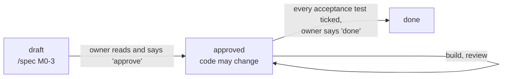

# Specs: how laterank is built

Every checkpoint gets a **spec**: a one-page plan written and approved *before* any code. It
records what will be built, the exact interfaces, the decisions and their reasons, and the tests
that prove it's done.

## The life of a spec



| status | meaning | what may change |
|---|---|---|
| `draft` | being written or discussed | only the spec |
| `approved` | the owner agreed to the plan | `src/` and `tests/`, following the spec |
| `done` | every acceptance test passes and is ticked | nothing; new work needs a new spec |

Only one spec can be `approved` at a time, so there's always exactly one checkpoint in progress.

## Changing the plan mid-way

The code may not quietly drift from the spec. If something has to change:
1. Edit the spec first.
2. Add a dated line under **Changes** saying what changed and why.
3. Tell the owner. A big change (a new interface, a dropped acceptance test) needs the owner's OK.

## What enforces this

| rule | enforced by |
|---|---|
| no edits to `src/` or `tests/` without an approved spec | Claude Code hook (`.claude/settings.json` → `scripts/specs.py claude-hook`) |
| only the owner moves a spec to `approved` or `done` | the same hook forces a permission prompt |
| every commit touching `src/` or `tests/` names its spec (`Spec: M0-3`) | git hook `scripts/git-hooks/commit-msg` |
| no Claude attribution in commits | the same git hook |
| every spec has the required sections and a valid status | `python3 scripts/specs.py check`, run in CI |

To turn on the git hook in a fresh clone, run this once:
`git config core.hooksPath scripts/git-hooks`.

The escape hatch for a tiny fix outside any checkpoint is the commit trailer
`Spec: none - <reason>`. It's visible in the history on purpose.

## Useful commands

```bash
python3 scripts/specs.py active        # which spec is in progress
python3 scripts/specs.py check         # validate every spec
git log --grep "Spec: M0-3"            # every commit that belongs to a checkpoint
```

## Files

- `_template.md`: copy this for a new spec (`/spec` does it for you).
- `<id>-<slug>.md`: one per checkpoint, e.g. `M0-3-storage.md`. Ids are `M<milestone>-<n>`.
